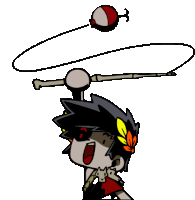

  

`UNITY` · `C#` · `PIXEL ART` · `FIGMA`

---

*Always learning. Always leveling up.*

---

##  PLAYER ACTIVITY 

<!-- pacman -->
<picture>
  <source media="(prefers-color-scheme: dark)" srcset="https://raw.githubusercontent.com/BeauBeannie/BeauBeannie/output/pacman-contribution-graph-dark.svg">
  <source media="(prefers-color-scheme: light)" srcset="https://raw.githubusercontent.com/BeauBeannie/BeauBeannie/output/pacman-contribution-graph.svg">
  
</picture>

---

**100% HADES ACHIEVEMENT**

*Thanks for stopping by, JPXFRD.*

