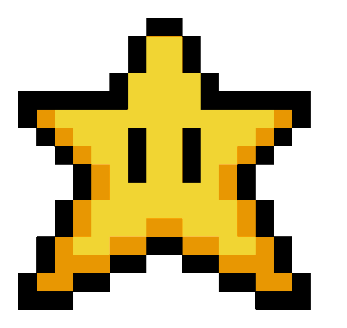

### JUNIOR UI/UX GAME ARTIST

`UNITY` · `C#` · `PIXEL ART` · `FIGMA`

*what is life without whimsy*

---

<table>
<tr>
<td width="50%" valign="top" align="center">

<h3 align="center">◈ CHARACTER STATUS ◈</h3>

<table>
<tr>
<td align="center" bgcolor="#241936"><b>ATTRIBUTE</b></td>
<td align="center" bgcolor="#241936"><b>DETAILS</b></td>
</tr>
<tr><td align="center">⚔️ Main Weapon</td><td align="center">Unity</td></tr>
<tr><td align="center">🛠️ Sub Weapon</td><td align="center">C#</td></tr>
<tr><td align="center">🎨 Crafting</td><td align="center">Figma, Aseprite</td></tr>
<tr><td align="center">🎮 Specialty</td><td align="center">Game UI</td></tr>
<tr><td align="center">✨ Passive Skill</td><td align="center">Player-First Mindset</td></tr>
<tr><td align="center">🏰 Guild</td><td align="center">Mega Cat Studios</td></tr>
</table>

</td>
<td width="50%" valign="top" align="center">

<h3 align="center">◈ SKILL TREE ◈</h3>

<table>
<tr>
<td align="center" bgcolor="#241936"><b>SKILL</b></td>
<td align="center" bgcolor="#241936"><b>LEVEL</b></td>
</tr>
<tr><td align="center">Unity UI</td><td align="center">⭐⭐⭐⭐⭐</td></tr>
<tr><td align="center">UI/UX Design</td><td align="center">⭐⭐⭐⭐</td></tr>
<tr><td align="center">Manual QA</td><td align="center">⭐⭐⭐⭐</td></tr>
<tr><td align="center">Pixel Art</td><td align="center">⭐⭐⭐⭐</td></tr>
<tr><td align="center">Figma</td><td align="center">⭐⭐⭐⭐</td></tr>
<tr><td align="center">C# Scripting</td><td align="center">⭐⭐⭐</td></tr>
</table>

</td>
</tr>
</table>

*Always learning. Always leveling up.*

---

## ◈ PLAYER ACTIVITY ◈

<!-- pacman -->
<picture>
  <source media="(prefers-color-scheme: dark)" srcset="https://raw.githubusercontent.com/BeauBeannie/BeauBeannie/output/pacman-contribution-graph-dark.svg">
  <source media="(prefers-color-scheme: light)" srcset="https://raw.githubusercontent.com/BeauBeannie/BeauBeannie/output/pacman-contribution-graph.svg">
  
</picture>

---

**100% HADES ACHIEVEMENT**

*Thanks for stopping by, fellow adventurer.*

`INSERT COIN TO CONTINUE`

